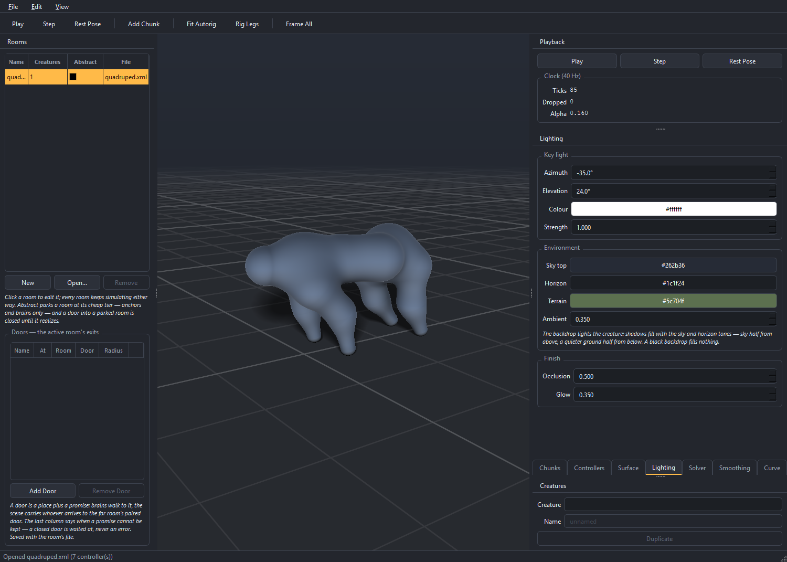
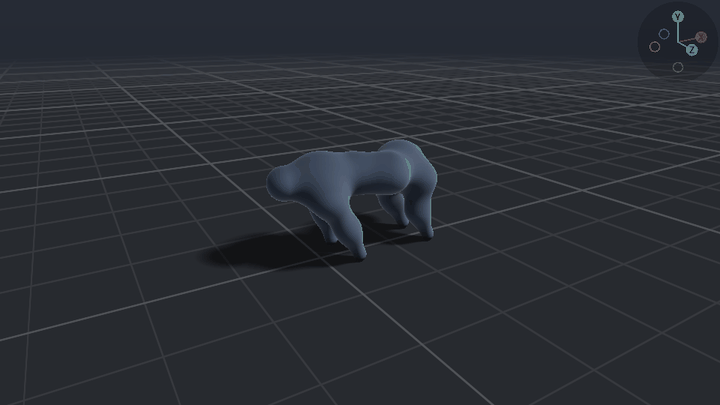
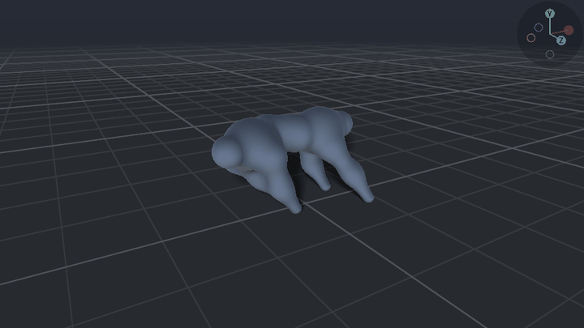

# mesh_xml

A procedural animation and metaball framework for soft, jointed creatures, modelled on
Rain World's approach: a body is a handful of masses joined by distance constraints, the
surface is a smooth field implied by them rather than a mesh anyone authored, and a
creature is something that thinks, walks, and exists whether or not anyone is looking.



## Quick start

```bash
poetry install
poetry run mesh-xml
```

Opens the editor on `examples/chubby_worm.xml`, or on any path given as the first
argument — a rig, or a `<scene>` manifest of several rooms. **Space** plays and pauses,
**F** frames the creature, **A** grows a chunk out of the selection, **R** toggles the
rig overlay, **O** goes orthographic, **1/3/7** snap the view, click selects, drag moves.

For a creature that walks: **File → Open Example → quadruped**, press Space. To author
one yourself, build a spine at standing height, grow three-chunk legs from it (hip,
knee, foot — ending near the floor), and press **Rig Legs** in the toolbar; the recipe
it compiles is the measured self-propelled walker, and the creature walks the way its
spine points, on footfalls against friction, with no pins and no kinematic carry.



*The same clip, smaller and unquantized: [walk.webm](docs/walk.webm).*

## What's here

* **A soft-body core** — chunks and typed links under a fixed-timestep Verlet solver
  with momentum-conserving projection, position-level Coulomb friction, angle limits
  compiled to brace links, opt-in self-contact, and SDF terrain.
* **A metaball surface** — round cones along the links, folded by smooth minimum within
  a creature and hard minimum between them, sphere-traced in a GL 3.3 raymarcher that a
  float64 CPU oracle checks numerically. Bound culling, tiled broad phase and a cone
  prepass keep herds cheap; every optimisation carries a stated exactness contract.
* **Procedural gaits** — spines that follow, two-bone IK, foothold state machines,
  posture and balance, an autorig that fits them to a shape, and `Rig Legs`, which
  compiles a measured walker onto any leg-shaped appendage.
* **Brains** — a behavior tier above the controllers, obeying the same law one level
  up (brains write goals, never forces): a state-machine grazer, a planning hunter, a
  utility scavenger. `examples/scavenge.xml` is a three-species food chain in one file.
* **Rooms and scenes** — `Room` as the unit of simulation, scenes of many rooms on one
  clock, doors that carry creatures between them, abstraction that drops an unwatched
  room to anchors-and-brains, and a scene manifest so the assembly survives a cold
  start.
* **Skins** — per-chunk colour folded beside the distance field by the same blend
  weight, stripe and countershade patterns riding each link's own frame, painted from
  the editor and saved with the rig.
* **An authored look** — one key light on azimuth/elevation knobs, a background
  gradient that doubles as the ambient fill (shadows cool toward the sky and horizon
  tones instead of tracking the key), SDF occlusion in the creases, a rim the skin
  carries, and the whole record saved per room as `<look>`.
* **Exports** — watertight OBJ/STL by surface nets over the same field, with vertex
  colours carrying the skin; a painted herd arrives in Blender as separate, painted
  animals.
* **The editor** — document/command architecture with full undo, dockable panels, a
  rooms dock, paint and pattern gestures, a toolbar of the core verbs, and a dark
  theme sourced from the viewport's own palette.



*The same clip, smaller and unquantized: [keylight.webm](docs/keylight.webm).*

## Architecture

```
mesh_xml/
  core/     body.py solver.py curve.py distance.py terrain.py   pure math — no Qt, no GL
  io/       xml_v2.py xml_legacy.py scene_xml.py mesh_export.py serialization, versioned
  anim/     clock.py controller.py autorig.py behavior.py       fixed-timestep driving
    controllers/  spine, limb IK, footholds, balance, drive     force, never position
  scene/    room.py scene.py door.py transfer.py                simulation without a window
  render/   draw_points.py sdf.py field.py tiles.py meshing.py  surface + visual smoothing
    gl/     context.py camera.py metaball.py shaders/           core-profile 3.3
  editor/   document.py viewport.py panels.py theme.py app.py   Qt, commands, undo
```

The dependency rule is one-directional: `core` imports nothing from the others, `scene`
imports no Qt (a test proves it), and only `render/gl/` may import OpenGL.

### The body is a graph, not a hierarchy

A `Body` holds chunks — position, radius, inverse mass — joined by undirected distance
constraints. There is no parent transform at simulation time, exactly as Rain World's
`PhysicalObject` has none. Cycles are legal, because the topologies worth building (a hip
girdle, a ribcage, a palm) are cyclic. Hierarchy is derived on demand when something needs
a tree, and the derivation is total: non-tree edges are reported, never dropped.

Chunk identity is a stable integer id. Names are an editable field and may repeat.

### Links do the work

A `Link` carries a rest length and a type — `NORMAL` holds distance in both directions,
`PULL` resists only stretching, `PUSH` only compression. That distinction is what separates
a spine from a rope, and it is Rain World's `BodyChunkConnection` in all but name. Angle
limits compile to exactly these links, and a `render` flag lets a mechanism brace carry
force without carrying flesh.

### Draw positions are not chunk positions

`render/draw_points.py` keeps a second set of points that chase the chunks through damped
springs, arriving late and overshooting. That lag is the secondary motion. Rain World's
bodies read as gelatinous because of this layer, not because the physics is soft.

### Controllers contribute force, never positions — and brains write goals

Constraint projection runs immediately after integration and will undo anything a
controller places. So controllers state where they want to go — via `ControlContext.seek` —
and the solver decides what the body can do about it. One level up, a brain writes goals
(destinations, choices) and steers only its own pinned anchor; `ctx.peers` is the room's
population, and a creature in another room is unsensed by construction.

### The surface is built from links

Every SDF primitive is a round cone — a capsule with a different radius at each end — so
radius varies continuously along a chain. A chunk contributes a primitive only when nothing
links it, since a cone already contains its end spheres. The skin rides the same fold: the
smooth minimum's own blend weight mixes per-chunk colour, so the paint can never disagree
with the flesh about where a blend is.


## Where the decisions live

In the tests. The design documents that used to sit here were removed deliberately: an
audit found they had drifted from the code in ways that were actively misleading — a
texture-unit roster that would hand the next reader a collision the code had already
been bitten by and fixed, cost arguments that cut features on arithmetic nobody
measured, invariants stated absolutely and tested only on the cases where they hold.
Prose cannot be executed, so it rots silently while the suite stays green.

The history is in git if you want it. What holds today is what `tests/` asserts.

## Development

```bash
poetry run pytest -q
```

```bash
poetry run ruff check .
```

`examples/` holds authored rigs, every one a v3 document that carries its own gait —
open it, press Play, it moves. `tests/data/` holds fixtures, including one deliberately
kept in the pre-versioning coordinate format as a regression case for the legacy reader.
The retired original application is recoverable at the baseline commit:
`git show ec05cdf:main.py`.
