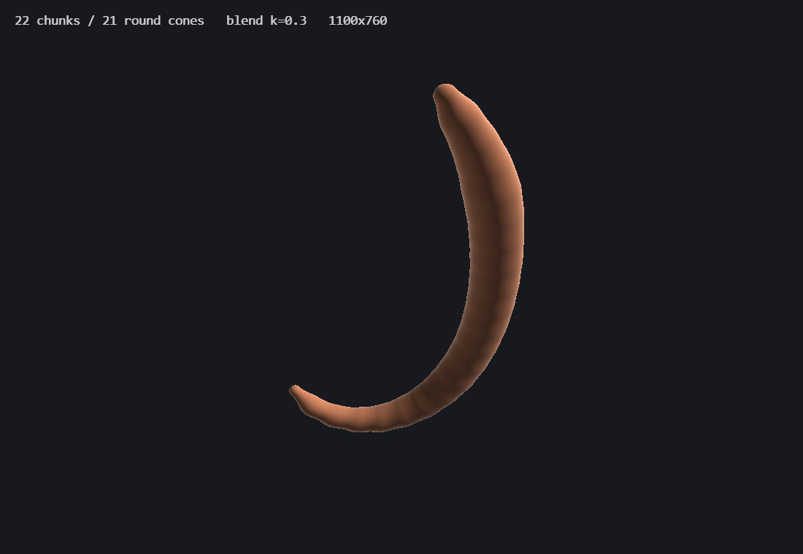
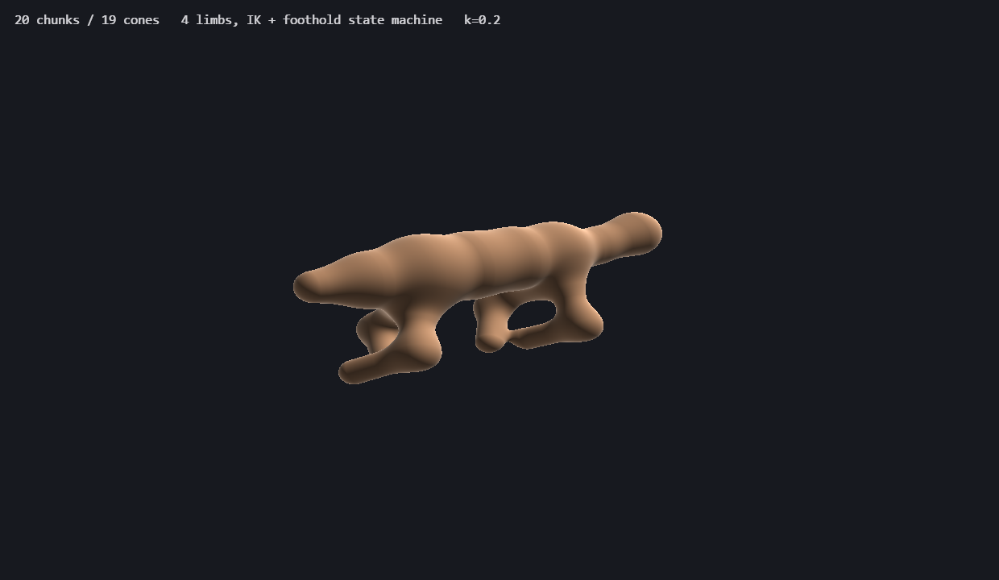

# mesh_xml

A procedural animation and metaball framework for soft, jointed creatures, modelled on
Rain World's approach: a body is a handful of masses joined by distance constraints, and
the surface is a smooth field implied by them rather than a mesh anyone authored.

## Status

Mid-refactor. The original application — an XML sphere-placement editor built on
fixed-function OpenGL — has been retired; see [docs/REFACTOR_PLAN.md](docs/REFACTOR_PLAN.md)
for the diagnosis, the phase plan, and a progress log.

```bash
poetry run mesh-xml
```

Opens the editor on `examples/chubby_worm.xml`, or on a path given as the first argument.
Space plays and pauses, `F` frames the rig, `R` toggles the rig overlay, click selects and
drag moves. The original app is recoverable at the baseline commit: `git show ec05cdf:main.py`.

```bash
poetry run python examples/quadruped.py
```

Builds a four-legged creature driven by a foothold state machine and two-bone IK, walks it,
and reports what it did.

| Layer | State |
| --- | --- |
| `core/` — body graph, solver, curves | done |
| `io/` — v2 format, legacy reader | done |
| `anim/` — fixed-rate clock | done |
| `render/` — smoothing, SDF packing, CPU field, GL scaffolding | done |
| `render/gl/shaders/` — metaball raymarcher | done |
| `editor/` — document, commands, viewport, panels | done |
| `anim/controllers/` — spine, limb IK, footholds, propulsion, balance | done |
| `render/meshing.py` + `io/mesh_export.py` — OBJ/STL export | done |
| `io/` v3 — gaits save with the body | done |



22 chunks, 21 round cones, blend radius 0.30 — imported, retapered by a curve,
simulated, smoothed, and raymarched.

## Architecture

```
mesh_xml/
  core/     body.py solver.py curve.py     pure math — no Qt, no OpenGL
  io/       xml_v2.py xml_legacy.py        serialization, versioned
  anim/     clock.py                       fixed-timestep driving
  render/   draw_points.py sdf.py field.py surface + visual smoothing
    gl/     context.py camera.py program.py  core-profile 3.3
```

The dependency rule is one-directional: `core` imports nothing from the others, and only
`render/gl/` may import OpenGL.

### The body is a graph, not a hierarchy

A `Body` holds chunks — position, radius, inverse mass — joined by undirected distance
constraints. There is no parent transform at simulation time, exactly as Rain World's
`PhysicalObject` has none. Cycles are legal, because the topologies worth building (a hip
girdle, a ribcage, a palm) are cyclic. Hierarchy is derived on demand when something needs
a tree, and the derivation is total: non-tree edges are reported, never dropped.

Chunk identity is a stable integer id. Names are an editable field and may repeat.

### Links do the work

A `Link` carries a rest length and a type — `NORMAL` holds distance in both directions,
`PULL` resists only stretching, `PUSH` only compression. That distinction is what separates
a spine from a rope, and it is Rain World's `BodyChunkConnection` in all but name.

### Draw positions are not chunk positions

`render/draw_points.py` keeps a second set of points that chase the chunks through damped
springs, arriving late and overshooting. That lag is the secondary motion. Rain World's
bodies read as gelatinous because of this layer, not because the physics is soft.

### Controllers contribute force, never positions

Constraint projection runs immediately after integration and will undo anything a
controller places. So controllers state where they want to go — via `ControlContext.seek` —
and the solver decides what the body can do about it. A controller that writes positions
does not fail cleanly; it buzzes, or works until a link tightens.



### The surface is built from links

Every SDF primitive is a round cone — a capsule with a different radius at each end — so
radius varies continuously along a chain. A chunk contributes a primitive only when nothing
links it, since a cone already contains its end spheres.

## Development

```bash
poetry install
```

```bash
poetry run pytest -q
```

```bash
poetry run ruff check .
```

`examples/` holds authored rigs, `tests/data/` holds fixtures — including one deliberately
kept in the pre-versioning coordinate format, as a regression case for the legacy reader.
